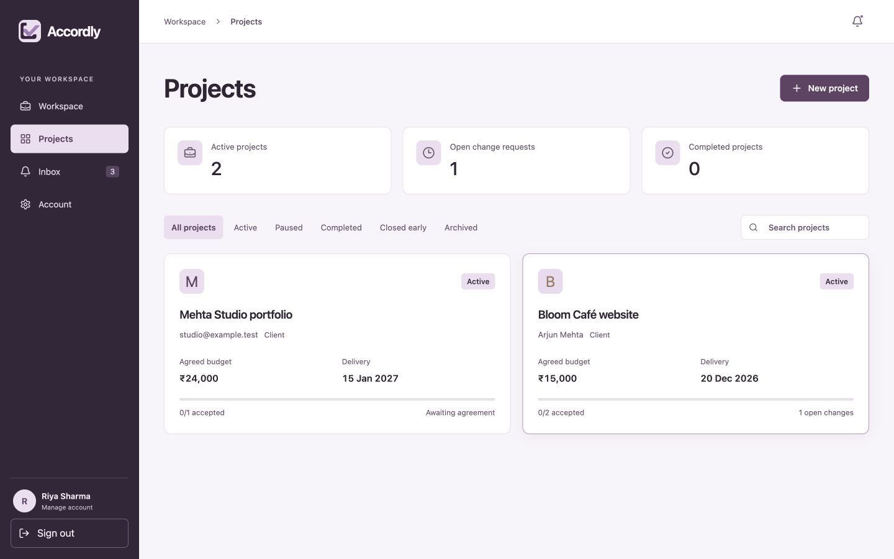
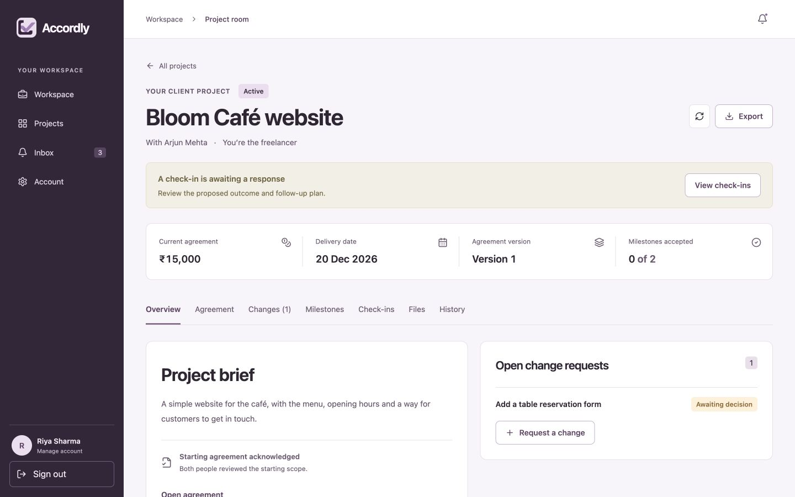
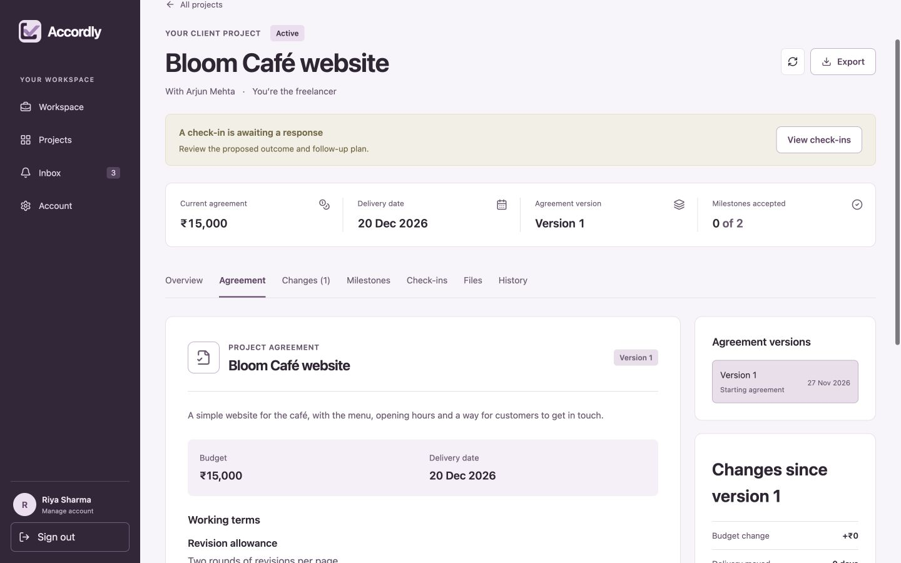
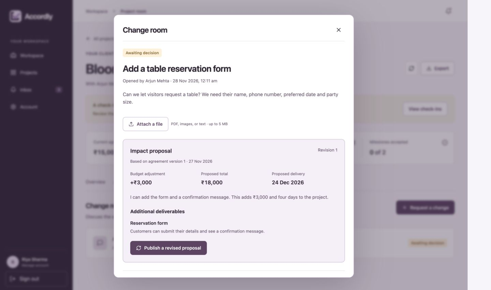
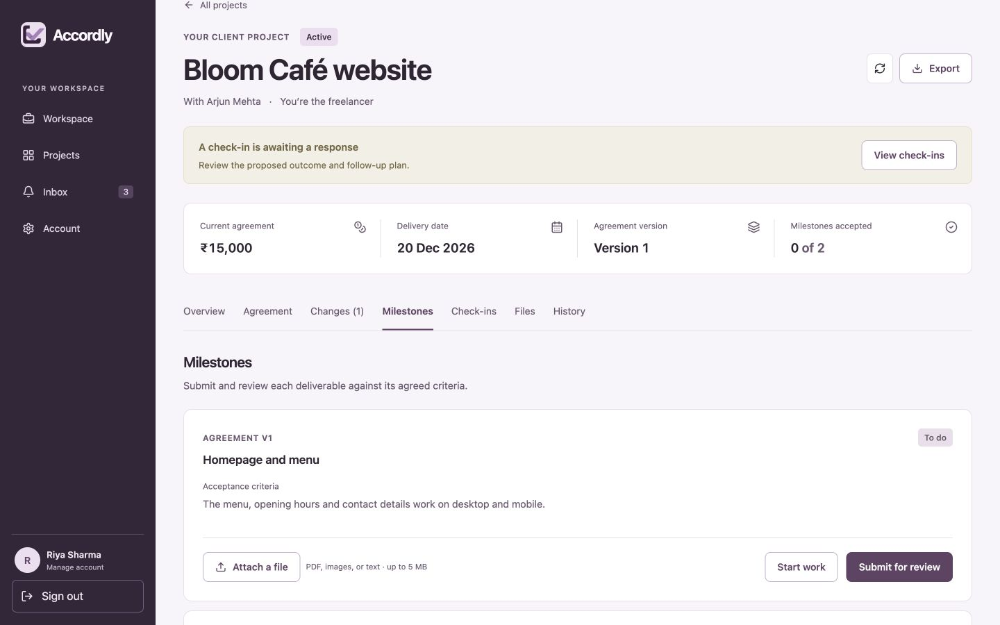
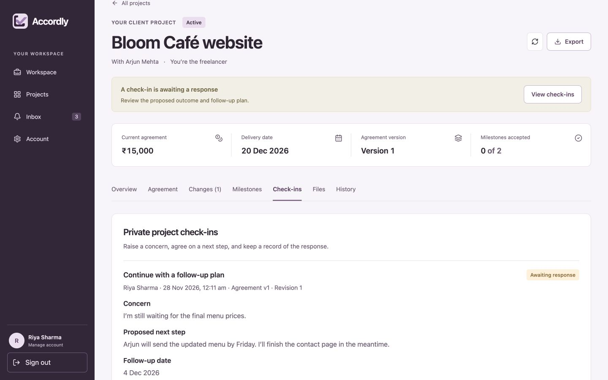
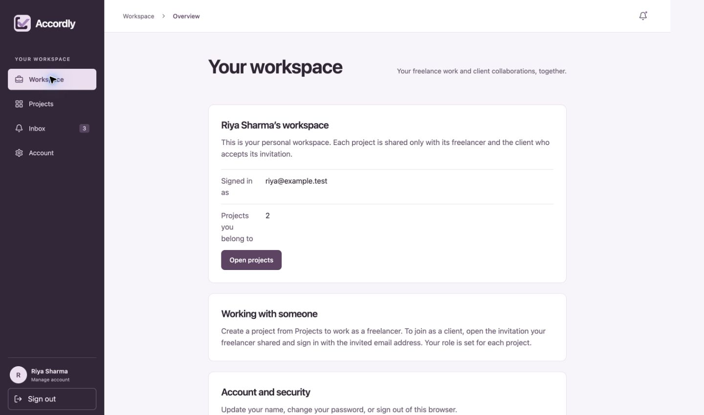
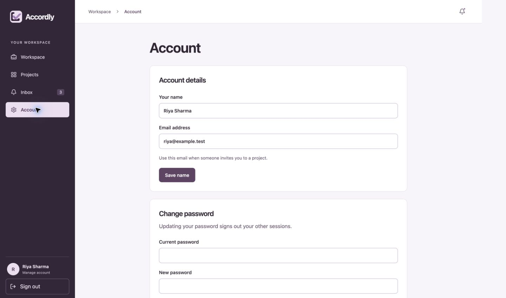
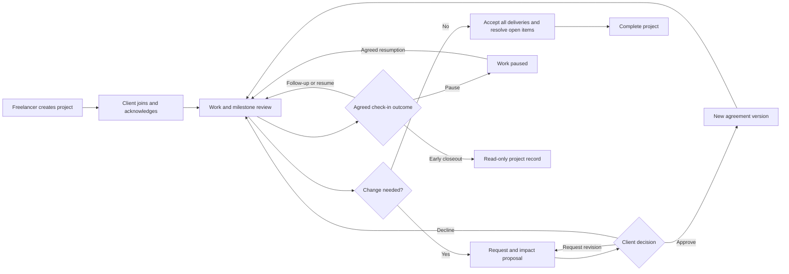

# Accordly

[Open the live app](https://accordly-5uv0.onrender.com)

**A shared project room for freelancers and clients.** Agree on the starting brief, track proposed changes, review delivery, and keep a clear record of decisions in one place.

Freelance projects often drift through scattered chats: a request changes the price, a deadline moves, or a deliverable is reviewed without a shared record of what was approved. Accordly gives both people the same project history. It makes the next step visible while keeping the working relationship collaborative.

> Accordly records agreements and acknowledgments. It does not process payments or provide a certified electronic signature.

## What you can do

| Area | Freelancer | Client |
| --- | --- | --- |
| Project setup | Create a brief, budget, deadline, milestones, and working terms | Join through an email-bound invitation and acknowledge the starting agreement |
| Scope changes | Estimate the cost, schedule, and deliverable impact; revise a proposal | Approve, decline, or request a revision before the agreement changes |
| Delivery | Upload files and submit milestones for review | Accept delivery or request revisions against the agreed criteria |
| Check-ins | Raise a concern, propose a follow-up, pause, resume, or early closeout | Respond to the proposed next step; either person can start a check-in |
| Project record | Review agreement versions, files, and activity; export JSON history | See the same project record and decisions |

One account can be a freelancer on one project and a client on another. Project access follows membership and role, rather than a fixed account type.

**Workspace** opens your personal workspace overview and project count. **Account** lets you edit your display name and change your password. A labeled **Sign out** button is available in the sidebar and on the Account page; it revokes the current session and returns to sign-in.

## A tour of the product

These are screenshots of the running app at a 1440 × 900 laptop viewport, captured on 28 November 2026 with fictional demo accounts and projects.

### 1. Find your projects

The dashboard lists active and completed projects, current budget, milestone progress, and pending work. Search by project name or filter by status. **New project** opens the setup form.



### 2. Set a shared starting point

The freelancer enters the project brief, client email, price, due date, deliverables, optional milestone review dates, and terms for revisions, payment, and early exit. Accordly records agreement version 1. The freelancer copies a seven-day, single-use invitation link for the intended client. The client joins using the matching email address and acknowledges the agreement after reviewing it.

The project room has **Overview, Agreement, Changes, Milestones, Check-ins, Files, and History** tabs. The Agreement tab keeps each version available, so an approved change does not erase the original terms.





### 3. Discuss a change before committing to it

Either person opens a change request. The freelancer posts an impact proposal with a cost adjustment, new deadline if needed, explanation, and any added deliverables. The client can approve, decline, or ask for a revision. An approval updates the agreement and its history together. A stale proposal cannot be approved after the agreement has moved on.



### 4. Deliver and review work

The freelancer marks milestones in progress, attaches files, and submits them. The client reviews each milestone against the recorded acceptance criteria and either accepts it or asks for a revision. The Files tab contains shared project files; the History tab shows the decision trail.



### 5. Handle a difficult moment professionally

A **Check-in** lets either person state a concern and propose a next step. The author can edit, withdraw, or delete a pending check-in; the other person accepts or declines the revision they saw. Resolved records remain in the project history.



If a pause is accepted, the project clearly shows that new work and scope changes are paused. Submitted milestones can still be reviewed. Resuming requires another accepted check-in.

Once a resumption is accepted, the project becomes active again, with the earlier check-ins still visible.

An agreed early closeout records the handover and outstanding items and makes the project read only. Accordly documents what both people entered; payment happens outside the app.

### 6. Manage your workspace and account

Open **Workspace** for your project count and shortcuts. Open **Account** to update your name or password. **Sign out** is available in the sidebar and Account page.





### Full workflow



## Run locally

Requires **Node.js 24 LTS+**, npm, and a PostgreSQL database. For local development, create a free Supabase project or install PostgreSQL, then set its connection string as `DATABASE_URL` in `.env`.

Copy `.env.example` to `.env` first and replace the placeholder database URL. Existing SQLite data is not automatically transferred to PostgreSQL.

```sh
npm ci
npm run setup
npm run dev
```

Open **http://localhost:5173**. Express runs on port 3001; Vite forwards `/api` to it. Use `localhost` consistently because `APP_ORIGIN` validates browser mutation requests.

There are no seeded accounts or default passwords. To try both sides, create a freelancer account, create a project, copy the invitation link, then open that link in another browser profile and register with the exact client email entered in the project. Review and acknowledge the starting agreement as the client.

## Stack and project layout

- **Frontend:** React 19, TypeScript, React Router, Vite, Lucide icons.
- **Backend:** Express 5, validated inputs, role and project membership checks, rate limits, security headers, and same-origin mutation checks.
- **Persistence:** Prisma ORM 6.19.3, checked-in PostgreSQL migrations.
- **Authentication:** Database-backed opaque sessions, HttpOnly cookies, scrypt password hashes, and session revocation on password change.

```text
client/              Dashboard, auth, project rooms, change and check-in UI
server/              Express routes, authentication, authorization, transactions
prisma/schema.prisma Data model and relationships
prisma/migrations/   Versioned PostgreSQL migrations
scripts/setup.mjs    Environment and database setup
public/              Brand asset
docs/screenshots/    Sample walkthrough screenshots
```

The **13 database tables** are `User`, `Session`, `Project`, `Agreement`, `Deliverable`, `ChangeRequest`, `Proposal`, `Comment`, `Invitation`, `Event`, `Attachment`, `Notification`, and `ProjectCheckIn`.

Amounts are stored as integer minor units (for example, paise), and deadlines as calendar dates. Agreements retain snapshots of the brief, budget, deadline, and deliverable criteria. File uploads are stored in PostgreSQL, limited to 5 MB per file and 100 MB per project, validated by type, and available only to project members. The API supports PDF, PNG, JPEG, WebP, and UTF-8 text files. Keep demo uploads small because Supabase Free has a 500 MB database quota.

## Rules that protect the shared record

- Every project URL checks the signed-in user's membership before handling inputs or uploads. Project, export, request, and file reads also include membership in the database query. Unrelated users receive a generic 404; nested request, milestone, and check-in IDs must belong to the project in the URL. Mutation handlers recheck membership and the required role inside their transaction.
- Invitations are bound to the client's email, expire after seven days, and can be used once. Regenerating a link invalidates the older one. Links are copied manually; the app does not send email.
- Proposal revisions are immutable. Only the client can decide on a published proposal, and an approval must match its revision and the agreement version it was based on.
- Applying an approval updates the agreement, project budget and deadline, deliverables, request, event history, and notification in one transaction. Repeated or stale decisions cannot apply the same change twice.
- Milestone review and check-in decisions use revision checks. Files and recorded events cannot be silently removed through the UI.
- A project can be completed only after submitted milestones are accepted and pending requests are resolved. Completed, archived, and early-closed projects are read only according to their workflow.

## API overview

| Route group | Purpose |
| --- | --- |
| `/api/auth/*` | Register, sign in/out, current account, display-name editing, password change |
| `/api/projects/*` | Project list, creation, agreements, invitations, milestones, status, export |
| `/api/invites/*` | Inspect and accept a client invitation |
| `/api/projects/:id/requests/*` | Change requests, proposals, decisions, discussion |
| `/api/projects/:id/check-ins/*` | Check-in CRUD and decisions |
| `/api/projects/:id/attachments`, `/api/attachments/:id` | Member-only file upload and download |
| `/api/notifications/*` | Inbox and read state |
| `/api/health` | Database readiness |

Mutations use the `X-Goti-Request: 1` header and an `APP_ORIGIN` check. Browser sessions use the `goti_session` cookie. The API returns structured JSON errors with appropriate HTTP status codes. The internal names `Goti` and `goti` remain in some code and configuration from an earlier working name; the product is **Accordly**.

## Build and deployment

```sh
npm run build
npm run db:migrate
NODE_ENV=production APP_ORIGIN=https://your-domain.example HOST=0.0.0.0 npm start
```

Express serves the compiled React app and API from one origin. A no-cost college demo can use **one Render Free web service with a Supabase Free PostgreSQL project**. The `render.yaml` Blueprint configures the app service. Create a Supabase project, copy its PostgreSQL connection string to Render's `DATABASE_URL`, and set `APP_ORIGIN` to the Render HTTPS service URL. Render supplies `PORT`; the Blueprint sets `HOST=0.0.0.0`, `NODE_ENV=production`, and `/api/health` as the health check. The Supabase database is external, so the Render service needs no disk. Use Supabase's session pooler connection string if direct database connectivity is unavailable.

Free services can sleep or pause after inactivity. A Render Free web service can take about a minute to wake after idle, and Supabase Free can pause a project after a week of low activity. Supabase Free has a 500 MB database quota and no automatic backups; it is intended for hobby projects rather than production. Keep demo records fictional, keep uploads small, and export important class-demo records. Check provider limits before provisioning. This setup is for a college demo and is not a production reliability promise.

This small demo setup is a starting point. Larger traffic would need workload testing, separate object storage, distributed rate limiting, and monitoring. Account recovery, email verification and delivery, billing, malware scanning, and certified e-signatures are outside the current version.

## Configuration and useful commands

Copy the keys from [`.env.example`](.env.example) into a local `.env` and set `DATABASE_URL` to a PostgreSQL connection string. Never commit `.env` or uploads. The repository includes the lockfile and migrations so another developer can reproduce the build and schema.

| Command | Purpose |
| --- | --- |
| `npm run setup` | Initialize the local database and apply migrations |
| `npm run db:migrate` | Apply checked-in migrations to an existing database |
| `npm run db:studio` | Inspect the local database in Prisma Studio |
| `npm run build` | Type-check and create production client and server builds |
| `npm run test:authorization` | Run isolated PostgreSQL and HTTP access-control regression checks |
| `npm start` | Serve the production build |

The authorization regression command requires local PostgreSQL tools (`initdb`, `pg_ctl`) on `PATH`. It creates its own temporary database and API server on loopback ports, uses fictional accounts, checks unrelated-user access, mixed project/item IDs, role restrictions, profile ownership, notification isolation, session revocation, pause and resume, early closeout, completion requirements, exports, and password changes, then removes its database. It never uses your configured `DATABASE_URL` or deployed data.

## Current limits

Proposals can add deliverables and adjust the price or deadline. Structured removal or redefinition of an existing deliverable is not yet supported; describe such context in the proposal while the original criteria stay in the agreement history. Project acknowledgments are a practical record, not a legal-signature certification.
